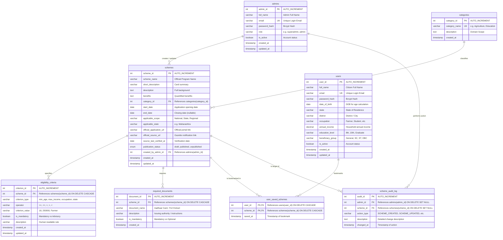

# Entity-Relationship (ER) Diagram
**Project:** Government Scheme Management and Eligibility Recommendation System  
**Database:** `government_scheme_db` (MySQL 8.0 / InnoDB)  

---

## 1. Mermaid Entity-Relationship Diagram

---

## 2. Cardinalities and Relationships Explained

1. **Category to Schemes ($1 : N$):**
   - One category can encompass multiple government schemes.
   - Each scheme must belong to exactly one category domain (`category_id` NOT NULL, `ON DELETE RESTRICT`).

2. **Scheme to Eligibility Criteria ($1 : N$):**
   - One scheme defines zero, one, or many atomic criteria rules.
   - Deleting a scheme automatically cascades and removes its dependent criteria (`ON DELETE CASCADE`).

3. **Scheme to Required Documents ($1 : N$):**
   - One scheme specifies multiple mandatory or optional supporting documents.
   - Deleting a scheme automatically cascades and removes its dependent document records (`ON DELETE CASCADE`).

4. **User to Schemes via Saved Schemes ($M : N$):**
   - A citizen can bookmark multiple government schemes.
   - A single scheme can be bookmarked by thousands of citizens.
   - Represented by junction table `user_saved_schemes` with composite primary key `(user_id, scheme_id)`.

5. **Admin to Schemes & Audit Logs ($1 : N$):**
   - An administrator creates schemes and triggers audit log records.
   - If an admin or scheme is deleted, historical audit entries are preserved via `ON DELETE SET NULL`.
